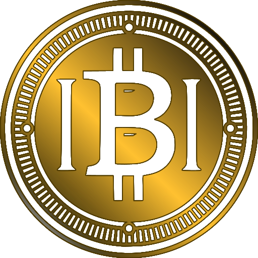

<p align="center">
  
</p>

<h1 align="center">IBITIcoin</h1>

<p align="center">
  Fixed-supply token and utility modules on BNB Smart Chain (BEP-20)
</p>

---

> ⚠️ **Disclaimer**  
> This repository is intended for developers, auditors and integrators.  
> Nothing in this repo is financial advice or an investment recommendation.

---

## Overview

**IBITIcoin** is an infrastructure project on **BNB Smart Chain**, built around a fixed-supply token and separate utility modules.

Live on mainnet:

- IBITI token (BEP-20, 8 decimals, 100,000,000 fixed supply, no owner, no fees)
- Team vesting
- Website sale at a fixed price, with a bonus and a referral reward
- Staking for 1 to 12 months, with a reward known in advance
- NFT collection: 11 cards bought with USDT, with no expiry and no burning

This repository contains the **public frontend** (static HTML/CSS/JS) for ibiticoin.com.

---

## Key links

- **Website:** https://ibiticoin.com
- **Whitepaper:** https://www.ibiticoin.com/whitepaper.html
- **Frontend (GitHub Pages):** https://vovan1980.github.io/ibiticoin.github.io
- **Smart contracts:** https://github.com/VOVAN1980/IBITIcoin

| Contract | Address |
|---|---|
| IBITI token | `0x71b552D3503fe20610aaA470A96E1838fae8381A` |
| Team vesting | `0xC4bdF5b6d7688a7d5457A194ac1210ec34003604` |
| Website sale | `0x42924EE213eF1943BE655c2C535FB72F52C64781` |
| Staking | `0x82BA8720FBa8a6A939D078b9ed62afB9ABC3B426` |
| NFT collection | `0x37F535AF03966CEFa35Bd6fe1d481831d9bc3a67` |
| NFT sale | `0x44E65077168De8Ff5EC6545857DAd2cB02310fe2` |

---

## Repositories

### Smart contracts

Solidity sources, scripts, tests and deployment records are in [IBITIcoin](https://github.com/VOVAN1980/IBITIcoin).

### Frontend & landing (this repo)

This repository contains:

- Public landing pages (RU/EN)
- Shop: website sale flow and purchase receipts
- Whitepaper (HTML and PDF)
- Staking page and NFT gallery
- Legal pages (privacy, terms, comment policy, etc.)

Static stack: **HTML + CSS + vanilla JS** (no backend).

---

## Local development

The site is fully static, so any local static server works.

```bash
git clone https://github.com/VOVAN1980/ibiticoin.github.io.git
```

```bash
cd ibiticoin.github.io
```

```bash
npx serve .
```

---

## Security

See [SECURITY.md](SECURITY.md) for responsible disclosure rules and how to report a vulnerability.

---

## License

### Source code

All application code in this repository is licensed under the MIT License. See [LICENSE](LICENSE).

### Brand, logo & NFTs

The following are not covered by the MIT license:

- The IBITIcoin and IBITI names and brand
- Logos, visual identity and design elements
- All NFT artwork files (images in `/img` and related media)

These assets are governed by [LICENSE_TECHNOLOGY.md](LICENSE_TECHNOLOGY.md) and [LICENSE_OVERVIEW.md](LICENSE_OVERVIEW.md).

For partnerships, integrations or media usage of the IBITI brand, please contact info@ibiticoin.com.
